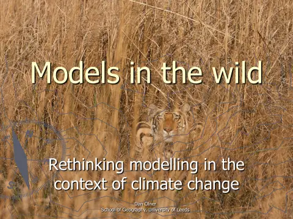

Talks converted into web slides. Move through them with the arrow keys, a click or a swipe; press <kbd>?</kbd> inside a deck for all the shortcuts.

### Models in the wild (2013)

[{fig-alt="Title slide: Models in the wild"}](models-in-the-wild-2013/index.html)

**[Models in the wild: rethinking modelling in the context of climate change](models-in-the-wild-2013/index.html)**

- Modelling on the Move seminar, September 2013. 66 slides.
- How can quantitative modelling live in the world? Compares orthodox modelling, agent-based 'virtual worlds' and social technology, with climate change and transport as the backdrop.
